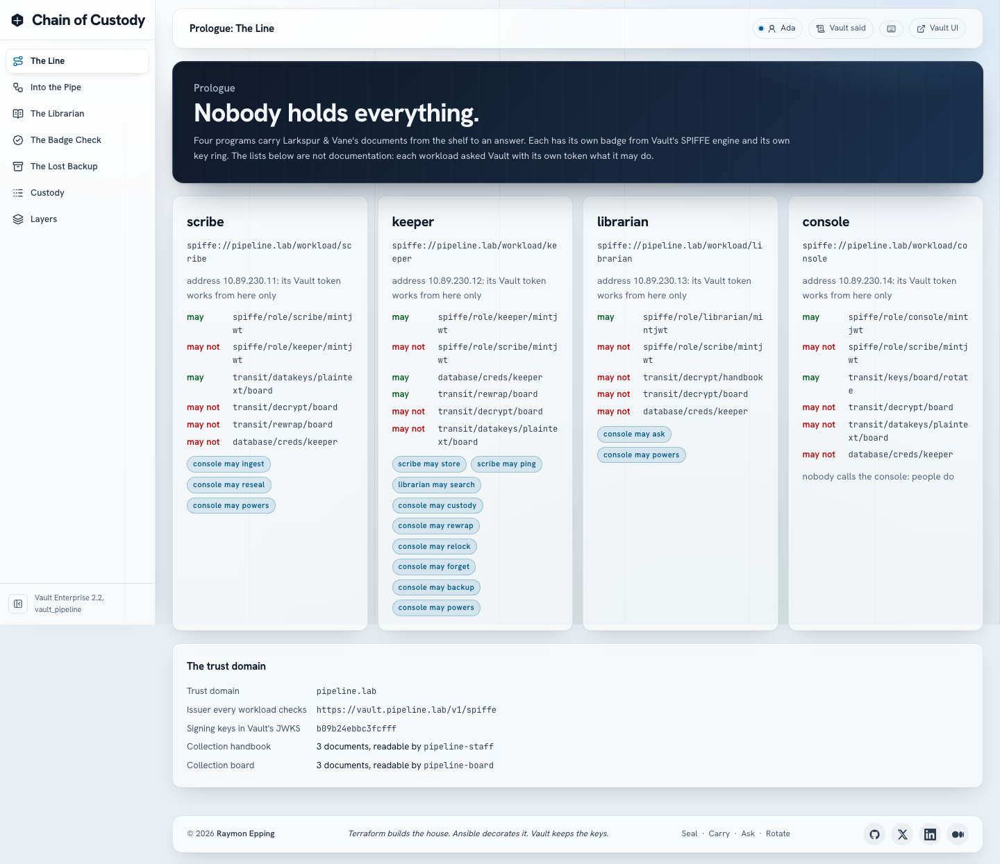

# vault_pipeline: Chain of Custody

> **Terraform builds the house. Ansible decorates it. Vault keeps the keys.
> Make is the front door.**

A small AI pipeline on one Mac, built so that no program in it holds more
than its own keys. A **scribe** seals documents, a **keeper** stores them, a
**librarian** answers questions with a local model, and a **console** is
where people ask. Each one is a workload with its own identity in Vault
Enterprise 2.2.1:

- it proves who it is to the others with a JWT-SVID from Vault's SPIFFE
  secrets engine, minted for one callee and valid for one minute;
- every document is sealed with Transit envelope encryption: one data key
  per document from `transit/datakeys`, and the key encryption key never
  leaves Vault;
- the keeper gets its database credential from Vault and never sees a
  data key; the librarian opens passages only with the asking person's
  Vault token, so it cannot read more for you than you may read.

The company in it, Larkspur & Vane, a lantern maker, is invented. So are its
documents and its people.



## The story

| Act | What you see | Vault feature |
| --- | --- | --- |
| Prologue: The Line | Four workloads, each with the paths Vault lets it use and refuses, asked by its own token | SPIFFE roles, one AppRole per workload, policies |
| I: Into the Pipe | Six documents sealed, six different data keys; the database holds ciphertext and vectors | `transit/datakeys`, JWT-SVIDs with an audience |
| II: The Librarian | Vera asks about the board: Vault refuses to open it for her. Ada asks: answered, with sources | JWT auth with Keycloak groups, decrypt with the asker's token |
| III: The Badge Check | Every workload's guest list, and the unit tests that prove each badge refusal | JWT-SVID audience, expiry, single-use `jti` |
| IV: The Lost Backup | The backup has no text; the console's token cannot open a key; rotate and rewrap; the backup's old keys refused | `token_bound_cidrs`, `rotate`, `rewrap`, `min_decryption_version` |
| Epilogue: The Custody Log | Who touched which document, when, append-only | the keeper's custody table, Vault's audit log |

Details and the full cast: [docs/STORY.md](docs/STORY.md).

**Proves:** a workload can only mint its own badge; a badge is bound to one
audience, expires in a minute and is accepted once; the storage tier never
sees plaintext; a deputy that acts with the asker's token cannot read more
than the asker; a token bound to an address is refused from any other;
rotation plus rewrap retires old encrypted keys without decrypting data.
**Illustrates only:** embeddings stored next to the ciphertext carry meaning;
a badge is a bearer credential for its minute; one Mac is not a production
pipeline.

## What you need

- An Apple Silicon Mac with Podman (machine with 8 GiB or more; the lab was
  measured on 12 CPUs, 48 GiB) and 8 GiB free disk (the models are 1.3 GB).
- Terraform 1.14, ansible-core 2.21, the vault CLI, Node 24 or later, jq,
  openssl.
- A Vault Enterprise licence with **SPIFFE Secrets Engine** in its features
  (`make license-features` lists them), as `VAULT_LICENSE` in `.env`.

## First run

```bash
make env-init          # .env from .env.example; put VAULT_LICENSE in it
make license && make gen-certs
make lab               # every phase, then the gates (about 10 minutes the first time)
make e2e-install       # Playwright, once
make rehearsal && make test-ui
```

Open <https://localhost:13801/> (`make trust-root` trusts the lab CA in the
macOS keychain) and sign in as `ada` (`make identity-copy-password U=ada`
puts the password on the clipboard). `vera` reads the handbook only;
`oscar` and `ada` may press the act buttons.

## Every day

| Task | Command |
| --- | --- |
| Start after `make down` or a reboot (105 s measured) | `make up` |
| Stop everything, keep every volume | `make down` |
| Before a talk: up, an empty story, the boundary | `make show-ready` |
| What is wrong, and the command that fixes it | `make doctor` |
| Every check that needs the lab | `make verify` |
| The story unattended (22 checks, about 35 s) | `make rehearsal` |
| One act from the terminal | `make act-ingest`, `act-ask`, `act-badges`, `act-backup` |
| A question from the terminal | `make ask AS=vera Q="What is Project Lighthouse?"` |
| All targets | `make help` |

## Ports (127.0.0.1 only)

vault-s 19300, vault-1..3 19301-19303, console API 13800, console web 13801,
Keycloak 13802. Postgres, Ollama, LDAP and the workloads publish nothing.

## Numbers (measured 2026-11-11, this Mac)

- `make up` from stopped: 105 s. `make rehearsal`: 22 checks in 29 to 35 s.
- Ollama 0.13.5 on the VM's CPU: an embedding of 1 KiB in 100 to 120 ms
  warm; `qwen2.5:1.5b` answers three passages at 11 to 28 tokens per second,
  9 to 22 s per answer.
- Act I seals six documents (24 frames, 11 KB of ciphertext) in about 3 s.

## Where things are

| Path | What |
| --- | --- |
| `config/pipeline.json` | workloads, addresses, guest lists, collections, people |
| `pipeline/` | the four workloads (one image) and their unit tests |
| `web/`, `e2e/` | the console (React, Vault daylight glass), Playwright with axe |
| `terraform/vault-seal`, `terraform/vault-platform` | declared structure |
| `ansible/` | order and moment: init, keys, schema, models, secret zero |
| `scripts/phases.txt`, `scripts/*.sh` | the phase list and every operation |
| `docs/` | [architecture](docs/architecture.md), [security model](docs/security-model.md), [operations](docs/operations.md), [ownership](docs/ownership.md), [what Vault does here](docs/capabilities.md), [state](docs/STATE.md) |
